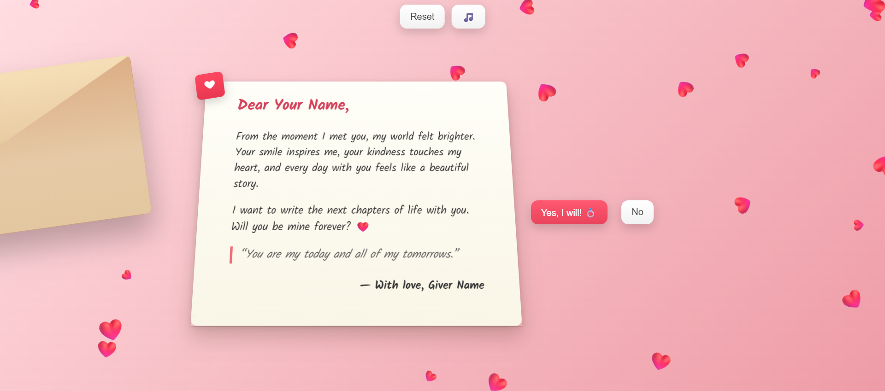

# 💌 Proposal Letter — Interactive Love Letter Animation

A beautiful, interactive proposal letter web app featuring:

- Animated envelope and 3D paper effect
- Personalized sender and receiver names (prompted every time)
- Playful Yes/No buttons (No button dodges the cursor)
- Confetti and heart rain effects
- Rose animation: blooms from the envelope and fills the screen on acceptance
- Romantic background music (plays only once per proposal/session)
- Fully responsive design for mobile and desktop

## Usage

1. Clone this repository:
   ```
   git clone https://github.com/ParmanandKS/Love_Letter
   ```
2. Open the `Love_Letter` folder.
3. Open `index.html` in your browser.
4. Follow the prompts and enjoy the interactive proposal experience!

## Features

- **Personalized:** Enter sender and receiver names each time.
- **Playful:** No button swaps with Yes, making it fun.
- **Visuals:** Confetti, hearts, and a blooming rose animation.
- **Music:** Romantic background music plays only once per proposal.
- **Responsive:** Works beautifully on both desktop and mobile.

## License

This project is licensed under the [MIT License](LICENSE).

---

## Screenshots

 <!-- Add your screenshot if available -->

---

## Contributing

Pull requests are welcome! For major changes, please open an issue first to discuss what you would like to change.

---

## Credits

- Rose and paper images: [Your sources or Unsplash/Pixabay]
- Music: [Your source or royalty-free music credit]

---
